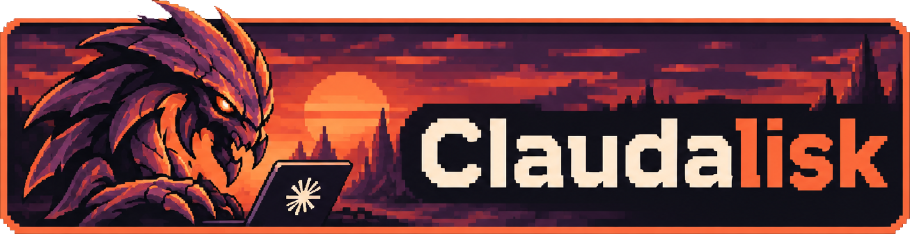

  

# Claudalisk

Reusable Claude Code configuration and guardrails for your projects. Pull it in and every project gets the same safety rails and agent setup, with no files copied by hand.

> **Status: early.** The design is still being worked out. Nothing here is ready to use yet.

## What it will provide

| Part | How a project gets it |
|---|---|
| Claude skills, slash commands, subagents | A Claude Code plugin. This repo is also a plugin marketplace. |
| Guardrails: prod safety, merge gate, destructive-command blocks | Plugin hooks, driven by a per-project config file |
| Generic agent guidance | A plugin skill and/or a scaffolded `AGENTS.md` section |

## Security

Hooks from this repo run with full access on your machine. **Pin a tag or commit SHA. Never track `main`.**

## Licence

[MIT](LICENSE)

## Not affiliated

Claudalisk is an independent project. It is not affiliated with, endorsed by, or sponsored by Anthropic (Claude) or Blizzard Entertainment (Hydralisk). All trademarks belong to their owners.
